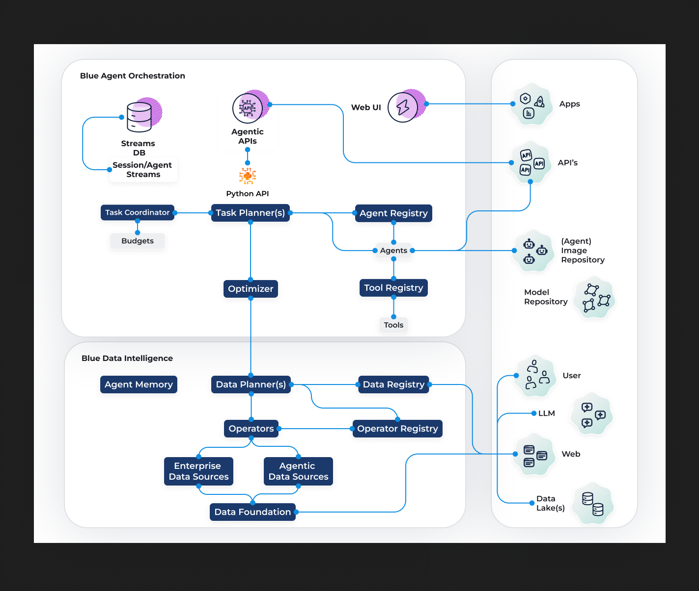

# Blue Data Intelligence

**A data intelligence layer for AI agents**

LLM-based agents can reason, plan, and call tools, but real-world tasks also require knowing *what data exists, what it means, and how to combine it* across systems that were never designed to work together. Today that knowledge is usually built into prompts, tool wrappers, and pipelines.

Blue Data Intelligence grew out of [Blue](https://github.com/megagonlabs/blue), Megagon Labs' open-source platform for orchestrating agents and data in the enterprise ([Kandogan et al., 2025](https://arxiv.org/abs/2504.08148)), and is now developed as a standalone data intelligence layer. Where Blue focuses on agent orchestration (streams, messages, sessions, and workflow execution), Blue Data Intelligence focuses on the data: it sits between agent frameworks and the underlying data systems and gives agents a uniform way to **discover**, **understand**, and **use** data across heterogeneous sources. 

Blue Data Intelligence can be used with any agent framework, and each component is independently usable, so you can adopt only the pieces you need.

Blue Data Intelligence provides:
- **A semantic data registry** that registers and introspects heterogeneous sources and enriches them with semantic metadata, so agents can discover what data exists, what it means, and how it relates.
- **Declarative data planning** that turns natural-language requests into executable plans over the registered data and operators, and repairs them when they fail.
- **Composable, versioned operators** that run those plans over structured data, text, and vectors through a common interface.
- **Enterprise and agentic data sources**: documents and knowledge bases alongside the web, LLM knowledge, and the personal user data, all queryable through the same registry.
- **Agent memory**: typed, governed memory building blocks that plug into any agent.

<p align="center">
  
</p>

## How it fits together

The diagram shows Blue Data Intelligence (bottom) beneath Blue's agent orchestration layer (top), connected to data that lives outside it (right): data lakes, the web, LLMs, and users.

A request moves through Blue Data Intelligence in three stages:

1. **Plan.** A data planner takes a natural-language request, from a user, an agent, or an upstream task planner such as Blue's, and decomposes it into a declarative plan: a DAG of data-processing steps. It consults the **data registry** (part of the data foundation) to find which sources hold relevant data, and the **operator registry** (part of the operators) to find which versioned operators can process it.
2. **Execute.** Operators run the plan's steps over enterprise data sources (documents, knowledge bases) and agentic data sources (LLMs, the web, the user) through a common interface.
3. **Ground.** The data foundation sits beneath every source. It connects to the physical data systems, such as databases, document stores, and data lakes, introspects them, and enriches them with semantic metadata, so plans are built on an accurate picture of what the data is and how it relates.

Agent memory sits outside this request flow. It plugs into the agents themselves, giving them persistent, governed memory that can be shared across agents.

Any agent framework can call the data planner directly, or use individual components such as the operators or a single data source on their own.

## Components

Blue Data Intelligence is split into separate repositories, one per component. Each can be installed and used on its own; the data sources and operators plug into the data foundation's registry when used together.

### Foundation

- **[Data Foundation](https://github.com/megagonlabs/blue-data)** (`blue-data`) registers, introspects, and queries heterogeneous data sources such as SQL databases, document stores, and graph databases, and enriches them with semantic metadata. Its data registry catalogs every source down to the attribute level, so agents can tell what data exists, what it means, how it relates, and how to query it safely.

### Planning and execution

- **[Data Planner](https://github.com/megagonlabs/blue-data-planner)** (`blue-data-planner`) turns a natural-language request into a declarative plan, a DAG of operator calls, then runs the plan and repairs it where it fails. Planners are operator-agnostic: they bind plan steps to whatever operators are registered.

- **[Operators](https://github.com/megagonlabs/blue-data-ops)** (`blue-data-ops`) is a library of reusable data operators, from record-oriented transforms to registry-backed database operations. Operators are versioned, so plans resolve to exactly the operator they were built against.

### Enterprise data sources

- **Relational, JSON, graph, and vector sources** are built into the [Data Foundation](https://github.com/megagonlabs/blue-data) (`blue-data`): relational databases such as PostgreSQL, MySQL, and SQLite; JSON stores such as MongoDB and Redis; graph databases such as Neo4j; and vector stores such as Redis and ChromaDB. They register, introspect, and query through the same data registry as every other source, with no separate repository to install.

- **[Document Data Source](https://github.com/megagonlabs/blue-data-doc-source)** (`blue-data-doc-source`) makes documents queryable alongside tables and graphs. It parses PDF, DOCX, and text files, extracts typed fields at ingest, and chunks, enriches, and embeds them, so agents can filter by document fields first and then retrieve and cite evidence within the right documents.

- **[Knowledge-Base Data Source](https://github.com/megagonlabs/blue-data-kb-source)** (`blue-data-kb-source`) is a typed knowledge graph with schema management. It extracts entities and facts from free text with provenance, and answers natural-language questions by traversing the graph.

### Agentic data sources

Many agent tasks depend on information beyond enterprise systems. These sources treat LLM knowledge, the web, and the user as queryable data sources, on equal footing with enterprise data.

- **[LLM Data Source](https://github.com/megagonlabs/blue-data-llm-source)** (`blue-data-llm-source`) turns a language model's own knowledge into structured records: a natural-language request goes in, and records shaped to a requested schema come out, with type checks and bounds on rows, time, cost, and calls.

- **[Web Data Source](https://github.com/megagonlabs/blue-data-web-source)** (`blue-data-web-source`) treats web pages as live data. It ingests URLs, feeds, and search results into a queryable index, and tracks freshness so unchanged pages are skipped on re-ingest and feeds can be monitored on a schedule.

- **[User Data Source](https://github.com/megagonlabs/blue-data-user-source)** (`blue-data-user-source`) is a per-user personal data store. It extracts structured data from a user's documents and conversations, answers natural-language queries over it, and asks the user to confirm stale data or fill in gaps when an answer would be incomplete.

### Memory

- **[Agent Memory](https://github.com/megagonlabs/Genie)** (`Genie`) provides typed building blocks for custom agent memory systems: memory blocks, parent/child ownership, typed relationships, scoped access, and optional structure views, with governance over how multiple agents access shared memory. It does not depend on any agent framework or database.


## Getting started

Each component can be installed individually from its own repository, which documents its installation and quick start and includes its own examples. Every Blue Data Intelligence component supports Python 3.12 and 3.13 (`requires-python = ">=3.12,<3.14"`). A typical path:

1. Start with the **[Data Foundation](https://github.com/megagonlabs/blue-data)** to register your data sources and build the data registry.
2. Add the **data sources** you need, such as documents, a knowledge base, the web, an LLM, or user data. Each registers into the same data registry.
3. Add **[Operators](https://github.com/megagonlabs/blue-data-ops)** and the **[Data Planner](https://github.com/megagonlabs/blue-data-planner)** to answer natural-language requests over everything you have registered.

**[Agent Memory](https://github.com/megagonlabs/Genie)** can be added to any agent.

## License

Blue Data Intelligence components are released under the BSD 3-Clause License (with Attribution / NOTICE Requirement), the same license as [Blue](https://github.com/megagonlabs/blue). See the `LICENSE` file in each repository.
<!-- TODO (release): this repo has no LICENSE file yet; add one. Confirm every component repo carries the same license text. -->

## Contact

Blue Data Intelligence is developed by [Megagon Labs](https://megagon.ai). For questions, contact [contactus@megagon.ai](mailto:contactus@megagon.ai). To learn more about Blue and Megagon Labs' research on compound AI systems, see the [Compound AI Systems research page](https://megagon.ai/research/compound-ai-system/).

## Citation

If you use Blue Data Intelligence in your research, please cite the Blue Data Intelligence paper:

```bibtex
@misc{aminnaseri2026bluedil,
  title         = {Blue Data Intelligence Layer: Streaming Data and Agents for Multi-source Multi-modal Data-Centric Applications},
  author        = {Moin Aminnaseri and Farima Fatahi Bayat and Nikita Bhutani and Jean-Flavien Bussotti and Kevin Chan and Rafael Li Chen and Yanlin Feng and Jackson Hassell and Estevam Hruschka and Eser Kandogan and Hannah Kim and James Levine and Seiji Maekawa and Jalal Mahmud and Kushan Mitra and Naoki Otani and Pouya Pezeshkpour and Nima Shahbazi and Chen Shen and Dan Zhang},
  year          = {2026},
  eprint        = {2604.15233},
  archivePrefix = {arXiv},
  primaryClass  = {cs.AI},
  url           = {https://arxiv.org/abs/2604.15233}
}
```

and, for the Blue architecture it builds on:

```bibtex
@inproceedings{kandogan2025orchestrating,
  title         = {Orchestrating Agents and Data for Enterprise: A Blueprint Architecture for Compound AI},
  author        = {Eser Kandogan and Nikita Bhutani and Dan Zhang and Rafael Li Chen and Sairam Gurajada and Estevam Hruschka},
  booktitle     = {First Workshop on Data-AI Systems (DAIS), ICDE 2025},
  year          = {2025},
  eprint        = {2504.08148},
  archivePrefix = {arXiv},
  primaryClass  = {cs.AI},
  url           = {https://arxiv.org/abs/2504.08148}
}
```
# Disclosures:

This software may include, incorporate, or access open source software (OSS) components,
datasets and other third party components, including those identified below. The license terms
respectively governing the datasets and third-party components continue to govern those
portions, and you agree to those license terms may limit any distribution, use, and copying.
You may use any OSS components under the terms of their respective licenses, which may
include BSD 3, Apache 2.0, and other licenses. In the event of conflicts between Megagon Labs,
Inc. (“Megagon”) license conditions and the OSS license conditions, the applicable OSS
conditions governing the corresponding OSS components shall prevail.
You agree not to, and are not permitted to, distribute actual datasets used with the OSS
components listed below. You agree and are limited to distribute only links to datasets from
known sources by listing them in the datasets overview table below. You agree that any right to
modify datasets originating from parties other than Megagon are governed by the respective
third party’s license conditions.
You agree that Megagon grants no license as to any of its intellectual property and patent rights.
THIS SOFTWARE IS PROVIDED BY THE COPYRIGHT HOLDERS AND CONTRIBUTORS (INCLUDING
MEGAGON) “AS IS” AND ANY EXPRESS OR IMPLIED WARRANTIES, INCLUDING, BUT NOT LIMITED
TO, THE IMPLIED WARRANTIES OF MERCHANTABILITY AND FITNESS FOR A PARTICULAR
PURPOSE ARE DISCLAIMED. IN NO EVENT SHALL THE COPYRIGHT HOLDER OR CONTRIBUTORS BE
LIABLE FOR ANY DIRECT, INDIRECT, INCIDENTAL, SPECIAL, EXEMPLARY, OR CONSEQUENTIAL
DAMAGES (INCLUDING, BUT NOT LIMITED TO, PROCUREMENT OF SUBSTITUTE GOODS OR
SERVICES; LOSS OF USE, DATA, OR PROFITS; OR BUSINESS INTERRUPTION) HOWEVER CAUSED
AND ON ANY THEORY OF LIABILITY, WHETHER IN CONTRACT, STRICT LIABILITY, OR TORT
(INCLUDING NEGLIGENCE OR OTHERWISE) ARISING IN ANY WAY OUT OF THE USE OF THIS
SOFTWARE, EVEN IF ADVISED OF THE POSSIBILITY OF SUCH DAMAGE. You agree to cease using,
incorporating, and distributing any part of the provided materials if you do not agree with the
terms or the lack of any warranty herein.
While Megagon makes commercially reasonable efforts to ensure that citations in this
document are complete and accurate, errors may occur. If you see any error or omission, please
help us improve this document by sending information to contact_oss@megagon.ai.
